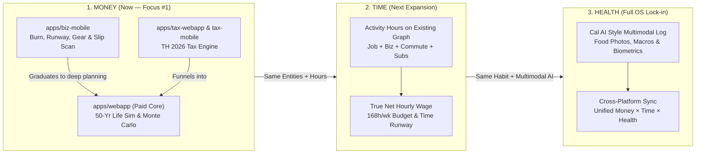

# excited.live — Master Business & Product PRD (Single Source of Truth)

> **Status**: Living Single Source of Truth — Updated 2026-10-17 (Strategic Alignment with Prame: Agentic-Era Customer Software OS, Biz-Mobile First, MeowJot-Style Slip Capture, External Agent / BYOA Priority, Money → Time → Health Horizon, Consumer-First Funnel).  
> **Motto**: "(I am) excited to live". `FromSukong` content funnels attention into the `excited.live` ecosystem.

---

## 1. Executive Vision: The OS for Customer Software in the Agentic Era

**`excited.live` is an Operating System for personal and solopreneur life in the agentic era.**

As software shifts from manual CRUD dashboards to personal AI agents (Claude, ChatGPT, Hermes, custom Telegram/LINE/Discord agents), users no longer want twenty disconnected apps where they have to type every form field by hand. Yet LLMs alone cannot be a person's life system: LLMs hallucinate math, lack deterministic multi-year simulation, forget structured state, and lack high-trust visual interfaces.

`excited.live` bridges that gap with a **4-Layer Agentic OS Kernel**:

1. **Proactive Zero-Friction Capture (Sensor Layer)**: Get real-world user data into the system as seamlessly as possible—starting with **MeowJot (เหมียวจด) style Thai bank e-slip reading** on mobile/API for Money, activity-duration tagging on existing spend/career items for Time, and **Cal AI style photo/multimodal logging** for Health.
2. **Pure Deterministic Engines (`packages/*`)**: Zero-hallucination TypeScript math engines (`@excited-live/accounting`, `@excited-live/tax`, `@excited-live/sim`, and future `@excited-live/time` & `@excited-live/health`) verified against independent Python recompute gates.
3. **Open Agent Surface — Bring Your Own Agent (`apps/api` + MCP + Scoped Keys)**: Instead of forcing users into an isolated in-app chatbot, we prioritize **opening the platform (`REST API` + `MCP` + `OpenAPI` + `llms.txt`)** with scoped Better Auth API keys so the **user's own personal AI agents** can read their numbers, ingest slips/events, run simulations, and stage actions on their behalf.
4. **High-Trust Human Cockpits (`apps/*` Mobile & Web)**: Fast, tactile mobile companions (`apps/biz-mobile`, `apps/tax-mobile`) for daily capture and instant runway awareness, channeling users into deep web workspaces (`apps/webapp`, `apps/tax-webapp`) for 50-year life visualization and decision sign-off.

---

## 2. The 3-Pillar Life OS Roadmap: Money → Time → Health

### Pillar 1: Financial OS (Current Priority)
- **Step 1A — Ship `apps/biz-mobile` First (Top-of-Funnel Daily Companion)**:
  - Solves immediate day-to-day financial clarity on mobile without accounting bloat: **Personal cash & burn runway**, **Fulltime Job career/salary "UNTIL" countdown**, **Multi-business side-hustle runways (`FromSukong`, etc.)**, **straight-line hardware depreciation**, and **capital transfers**.
  - **Proactive Slip Ingestion (MeowJot / เหมียวจด capability)**: Read Thai bank transfer e-slips (PromptPay QR payload + OCR) via mobile share sheet / camera / album or external agent upload, automatically recording expenses, matching recurring bills (preventing double-counting), and exposing the ledger via App, REST API, and MCP.
- **Step 1B — Channel Engaged Users to `apps/webapp` (Detailed 50-Year Life Planner)**:
  - Once users love tracking their present reality in `biz-mobile` (or calculating tax in `tax-webapp` / `tax-mobile`), we channel them into `apps/webapp` to answer *"Can I afford this life over the next 50 years?"*
  - Syncs current-year income, recurring burn, and business cashflows from `biz` directly into `packages/sim`'s 50-year projection, Monte Carlo P10–P90 bands, scenario toggles, what-if sliders, and ThaiESG/RMF tax optimizer.

### Pillar 2: Time Management OS (Horizon 2)
- **Zero-Cold-Start Time Planner**: Traditional time trackers fail because users have to build categories from scratch. Because Pillar 1 already knows **what the user spends on** (subscriptions, transit/BTS, rent), **where they live**, and **what jobs/businesses they operate** (`fulltime_job`, `business`), the user simply inputs **how many hours they spend on each existing entity/activity**.
- **Instant Life-Energy Metrics**:
  - **True Net Hourly Rate**: Real take-home pay (after tax, commute cost, gear depreciation, and work expenses) divided by true hours invested (work + commute).
  - **168-Hour Weekly Ledger & Time Runway**: Visualizes free vs. committed hours across Personal, Fulltime Job, and Side Ventures, letting agents answer *"If I spend 10 more hours/week on FromSukong, what is my ROI in both baht and hours?"*

### Pillar 3: Health & Energy OS (Horizon 3)
- **Cal AI-Class Multimodal Health Tracking**: Mirrors the frictionless e-slip capture from Pillar 1—snap a photo of a meal (or send it to your personal agent) to automatically log calories, macros, and nutrition, paired with cross-platform biometric/wearable sync.
- **Cross-Pillar Intelligence**: Connects food/fitness spending (Money), meal prep/sleep/workout hours (Time), and body composition/energy biomarkers (Health) in one unified data graph accessible to the user's AI agents.

---

## 3. Agentic Architecture & Mutation Contract

### 3.1 External Personal Agents First (BYOA > Built-in Chat)
- **Deprioritize Built-in Agent UI**: We do **not** compete to be the user's primary chat window. The in-app `AssistantRail` and automated multi-step agent workflows (e.g., autonomous tax/plan check-ins) are secondary and sequenced **after** core data connection.
- **Open Protocol Surface (`apps/api` + MCP)**: Every domain (`biz`, `tax`, `sim`, and later `time`, `health`) exposes clean, versioned endpoints (`/api/v1/*`), an **MCP server**, OpenAPI specs, and `llms.txt` authenticated via **Better Auth scoped API keys** (`packages/auth`).
- **Core Agent Jobs**:
  1. **Ingest**: User forwards a bank e-slip, receipt, or voice note to their personal agent → Agent writes the structured slip/transaction into `excited.live`.
  2. **Query & Explain**: User asks their agent *"How much runway does FromSukong have left?"* or *"How much did I spend on food this month?"* → Agent reads deterministic summaries from `/api/v1/biz` and `/api/v1/sim`.
  3. **Simulate & Propose**: User asks *"Can I buy a ฿45,000 MacBook or quit my job in 6 months?"* → Agent runs stateless simulations and stages a proposal for human visual review.

### 3.2 Two-Tier Agent Mutation Policy
To balance **zero-friction daily capture** with **long-term plan safety**:
- **Tier 1 — Append-Only Daily Capture (Direct Write with Audit Trail)**:
  - Scoped agent tokens (`biz:write`, `slip:write`, `time:write`, `health:write`) can directly record daily e-slips, recurring subscriptions, gear items, and time/meal logs.
  - Every agent-written record carries `source: "agent"` (or `"slip_ocr"`) and can be undone with one tap in the mobile/web ledger.
- **Tier 2 — Structural 50-Year Life Plan (`plan:propose` Invariant)**:
  - Long-term life plan mutations in `apps/webapp` (changing retirement age, wallet allocation splits, or multi-decade income/expense rows) remain **proposal-based**: agents stage a before/after diff (`US-103`), and the user explicitly clicks **Accept** on the web chart.

---

## 4. Go-To-Market & Monetization Funnel (Consumer / B2C First)

> Full pricing specification lives in [pricing.md](pricing.md). B2B Advisor seats and enterprise white-label are **deferred to second priority (Post-MLP backlog)** so we go 100% all-in on the consumer flywheel first.

1. **Free Top-of-Funnel (Habit & Graph Acquisition)**:
   - **`apps/biz-mobile`** (Burn, Runway, Gear Depreciation, Slip Capture) and **`apps/tax-webapp` / `apps/tax-mobile`** (TH 2026 Tax Calculator) launch as **free consumer entry points**.
   - **Contextual Provider Monetization (Affiliate / Sponsorship)**: Before charging casual mobile users, we monetize free top-of-funnel traffic via high-trust, contextual financial/tool affiliates (e.g., ThaiESG/RMF fund providers, high-yield savings, solopreneur tools) strictly aligned with the user's math.
2. **Stage 1 Paid Core — Detailed Web Planner (`apps/webapp`)**:
   - Users who want the full 50-year life simulation, Monte Carlo survival bands, scenario toggles, and tax-advantaged vs. S&P 500 real-return optimizer upgrade to the **$109/year subscription** (with a **7-day free trial**).
3. **Stage 2 Ecosystem Pro (Money + Time)**:
   - Once the Time Management pillar ships alongside Money on mobile and web, introduce a **Mobile/Cross-App Pro tier** unlocking advanced cross-pillar analytics, unlimited slip/agent automation, and cloud sync.
4. **Stage 3 Full OS Lock-in (Money + Time + Health)**:
   - Adding the Cal AI-style Health pillar completes the daily habit loop (every meal + every baht + every hour), creating durable subscription retention across the entire `excited.live` OS.

---

## 5. PRD Corpus Map (Document Index)

1. **[PRD.md](PRD.md) (This file)** — Master Business Vision, Agentic OS Architecture, 3-Pillar Roadmap (Money → Time → Health), Consumer Funnel, and Global Principles.
2. **[prd-biz-mobile.md](prd-biz-mobile.md) (Current Ship Priority #1)** — `apps/biz-mobile` + `packages/biz` + `/api/v1/biz`: Multi-entity solopreneur cash/burn/runway, straight-line gear depreciation, capital transfers, **MeowJot-style e-slip ingestion**, and Agent/MCP endpoints.
3. **[prd-mvp.md](prd-mvp.md) (Math & Sheet Baseline)** — The Google Sheet spec that proved the 50-year simulation and TH 2026 tax optimizer formulas (`packages/sim` + `packages/tax`).
4. **[prd-mlp.md](prd-mlp.md) (Detailed Web App — Paid Conversion Core)** — `apps/webapp`: 5-minute onboarding wizard, 50-year life-story chart, Monte Carlo P10–P90 bands, scenario toggles, what-if sliders, and external agent MCP/API integration.
5. **[prd-post-mlp.md](prd-post-mlp.md) (Phased Expansion & Backlog)** — Trigger-based roadmap: Time OS (Pillar 2), Health OS / Cal AI (Pillar 3), Built-in Proactive Agent Workflows, Real Exit-Tax Modeling, US Tax, and Deferred B2B Advisor / White-Label tier.
6. **[pricing.md](pricing.md) (Monetization & Funnel Spec)** — Consumer-first funnel (Free Mobile/Tax top-of-funnel + Affiliate → $109/yr Detailed Webapp → Pro Mobile Ecosystem for Money + Time + Health; Advisor B2B deferred).
7. **[prd-flows.md](prd-flows.md) & [wireframe-biz-mobile.md](wireframe-biz-mobile.md) & [tax-mobile-prd-and-ui-spec.md](tax-mobile-prd-and-ui-spec.md)** — Screen-by-screen user flows, Mobbin references, and mobile UI ergonomics.
8. **[plan-auth-migration.md](plan-auth-migration.md)** — Unified identity and token architecture (`packages/auth` via Better Auth + Cloudflare D1: web cookies, mobile bearer tokens, and scoped `apiKey` / OAuth for external agents).

---

## 6. Global Architectural Principles (All Phases & Pillars)

- **P1 (Pure Deterministic Engines)**: All domain math (`packages/biz`, `packages/tax`, `packages/sim`, and future `time`/`health`) lives in pure TypeScript packages—zero network, zero DOM, zero framework imports, verified by golden tests and independent Python recompute scripts.
- **P2 (Sheet & Golden Parity)**: Long-term projection and tax modules port the proven MVP sheet tabs 1:1; `packages/biz` reproduces verified solopreneur baseline targets to 2 decimal places.
- **P3 (Single API & Storage Boundary)**: `apps/api` (Hono + Cloudflare D1) is the unified backend boundary for web, mobile sync, and external AI agents. Local-first mobile state syncs cleanly to `/api/v1/*`.
- **P4 (Agent-Ready by Default)**: Every feature and data model added to `excited.live` must be queryable and operable by the user's external AI agent via `/api/v1/*` and MCP using scoped Better Auth API keys—not trapped inside UI-only state.
- **P5 (Two-Tier Mutation Safety)**: Daily ledger capture (slips, subscriptions, time/meal logs) supports direct authenticated agent writes with audit tags; structural 50-year life-plan edits require staged proposal diffs accepted by the human.
- **P6 (Bilingual EN/TH Everywhere)**: All user-facing strings use `@excited-live/i18n` `{ en, th }` dictionaries, English first, natural spoken Thai second.
- **P7 (Mastercard Design System & Astryx-First)**: Muted Canvas Cream (`#F3F0EE`), Lifted Cream (`#FCFBFA`), Ink Black (`#141413`), and Signal Orange (`#CF4500`). Raw HTML elements are banned in `apps/webapp/src` and `apps/biz-mobile/src` in favor of Astryx components (`@astryxdesign/core`) themed by `@excited-live/design-system`, which owns the Mastercard theme, icons, and zero-style native/brand primitives.
- **P8 (TH Tax First, ThaiESG Only)**: Thailand 2026 personal income tax is the active user-facing tax engine (US engine stays hidden in code until triggered). Discontinued SSF is never shown in new UI—ThaiESG and RMF only.
- **P9 (PRD Is the Single Source of Truth)**: No feature ships without being recorded in the PRD corpus first.

## 7. Global Non-Goals

- **No Brokerage or Bank Execution**: We read slips, track state, and simulate decisions—we never custody funds or execute trades/transfers.
- **No Bloated Corporate Accounting**: No VAT 7% filing, e-Tax invoices, 50 Tawi issuance, or double-entry general ledger bloat (leave corporate compliance to FlowAccount).
- **No Advisor/Enterprise Bloat Before Consumer PMF**: B2B advisor dashboards and white-label features stay strictly deferred until the consumer Money → Time → Health funnel is thriving.
