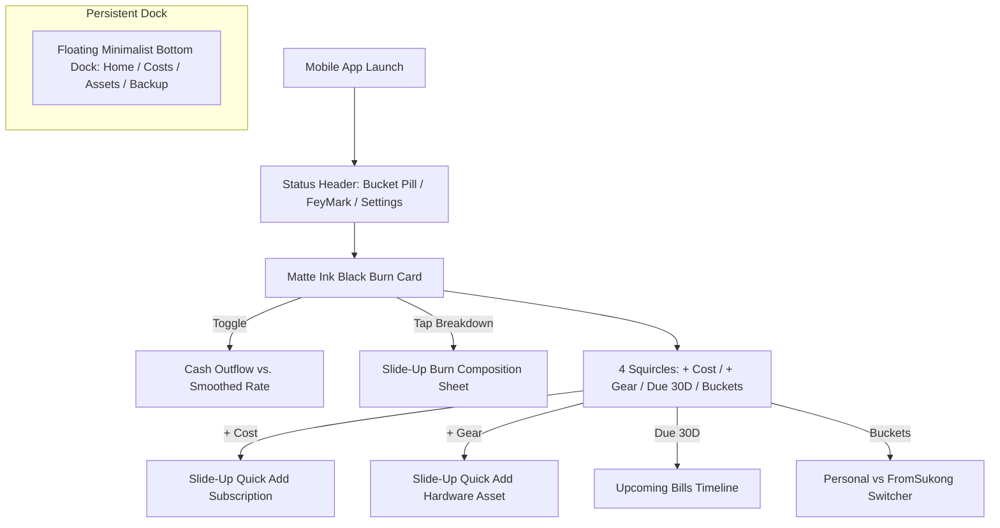

# Excited.Biz Mobile — PRD, Mobile Architecture & UI Specification

> **Status**: Approved for Day One Full Mobile App (updated 2026-10-13)  
> **Target Package**: [`apps/biz-mobile`](file:///home/prame/Project/excited.live/apps/biz-mobile)  
> **Core Engine**: [`packages/biz`](file:///home/prame/Project/excited.live/packages/biz) (Pure TypeScript math engine + Python recompute gate)  
> **Design Tokens**: Canonical Mastercard Design System ([`DESIGN.md`](file:///home/prame/Project/excited.live/DESIGN.md) & [`@excited-live/design-system`](file:///home/prame/Project/excited.live/packages/design-system))  
> **Native Framework**: Tauri v2 Mobile (Android first, iOS ready — identical pattern to [`apps/tax-mobile`](file:///home/prame/Project/excited.live/apps/tax-mobile))

---

## 1. Executive Summary & Product Vision

**Excited.Biz Mobile** is a luxury, privacy-first mobile spend and asset depreciation companion designed for personal use and solo-operator businesses.

### The Problem
Traditional accounting software (FlowAccount, ERPNext, QuickBooks) is bloated with compliance overhead (tax invoices, VAT filing, WHT certificates, general ledgers) that personal creators and solo founders do not need for day-to-day burn awareness. On the other hand, Google Sheets is clunky on mobile, brittle to maintain, and requires constant manual formula adjustments.

### The Solution: Day One Full Mobile App
Instead of starting with a web app and migrating later, **Excited.Biz launches directly as a native mobile application from Day One** (`apps/biz-mobile` powered by Tauri v2 and React 19). It answers one fundamental question in under 3 seconds:

> **"What do I actually spend per month?"**  
> *(Active recurring subscriptions + device straight-line depreciation, unified into a single confident burn rate)*

---

## 2. Core Baseline Targets (Verifiable Seed Data)

The engine and UI must reproduce the verified baseline numbers from Prame's live setup:

### A. Recurring Subscriptions & Regular Bills
| Item | Cycle | Amount (THB) | Monthly Equivalent | Notes |
| :--- | :--- | :--- | :--- | :--- |
| **BTS SkyTrain** | Monthly | ฿1,400.00 | ฿1,400.00 | Transit pass |
| **AIS Fibre** | Monthly | ฿540.00 | ฿540.00 | Home internet |
| **Opencode Go** | Monthly | ฿360.00 | ฿360.00 | Dev tool |
| **Mobile Internet** | Monthly | ฿170.00 | ฿170.00 | Cellular plan |
| **Make (Integromat)** | Monthly | ฿57.50 | ฿57.50 | Automation |
| **Domain Name** | Yearly | ฿360.00 | ฿30.00 | ฿30/mo amortised |
| **Phone Line** | Monthly | ฿20.00 | ฿20.00 | Backup SIM |
| **Total Recurring** | — | — | **฿2,577.50 / mo** | Baseline Target |

### B. Owned Gear & Straight-Line Depreciation Register
Straight-line formula: $\text{Depreciation/mo} = \frac{\text{Purchase Price} - \text{Salvage (0)}}{\text{Lifespan Months}}$  
Items fully depreciated floor at ฿0.

| Device / Hardware | Cost (THB) | Lifespan | Purchase Date | Monthly Rate | Current Status |
| :--- | :--- | :--- | :--- | :--- | :--- |
| **Workstation PC** | ฿30,000 | 5 yrs (60 mo) | Historical | ฿0.00 | **Fully depreciated** (฿0) |
| **iPad Gen 9** | ฿10,900 | 5 yrs (60 mo) | 2021-09 | ฿181.67 | Finishes Oct 2026 → ฿0 in Nov |
| **Nothing Phone 2a** | ฿10,000 | 5 yrs (60 mo) | 2024-03 | ฿166.67 | Active |
| **SoundCore Space 1** | ฿2,800 | 3 yrs (36 mo) | 2024-03 | ฿77.78 | Active |
| **SoundCore Open-Ear**| ฿1,000 | 3 yrs (36 mo) | 2026-05 | ฿27.78 | Active |
| **Amazfit Active Edge**| ฿3,000 | 3 yrs (36 mo) | 2025-08 | ฿83.33 | Active |
| **Total Depreciation** | — | — | — | **≈ ฿537.23 / mo** | Drops to **≈ ฿355.56** in Nov 2026 |

### C. Unified Headline Burn
- **October 2026 Baseline**: ฿2,577.50 (recurring) + ฿537.23 (depreciation) = **≈ ฿3,114.73 / month**
- **November 2026 Run-rate**: ฿2,577.50 (recurring) + ฿355.56 (depreciation) = **≈ ฿2,933.06 / month**

---

## 3. Visual & Mobile Ergonomics Specification

The mobile UI follows the luxury, paper-like minimalism of the **Mastercard Design System** and ergonomic mobile benchmarks (World App / Revolut / `apps/tax-mobile`):

### 3.1 Design Tokens
- **Canvas Cream (`#F3F0EE`)**: Page background, zero harsh digital white, zero neon gradients.
- **Lifted Cream (`#FCFBFA`)**: Elevated cards with authentic paper-on-paper depth.
- **Ink Black (`#141413`)**: Primary typography and high-contrast hero balance card.
- **Signal Orange (`#CF4500` / `#F37338`)**: Single brand focus accent for dots, primary indicators, and active badges.
- **Border Subtle (`rgba(20, 20, 19, 0.08)`)**: Crisp 1px hairline dividers.

### 3.2 Mobile Information Architecture & Screen Flow



### 3.3 Screen Breakdown
1. **Home Screen**:
   - **Header**: Active bucket pill (`Personal` ▾ `FromSukong` ▾ `All`), [`FeyMark`](file:///home/prame/Project/excited.live/packages/design-system/src/icons.tsx) emblem, Settings gear.
   - **Hero Burn Card**:
     - Large ink black card (`#141413`, 32px squircle radius).
     - Headline text: `฿3,115` with subtitle `PLANNED SPEND / MO`.
     - Segmented pill: `Cash View` (actual cash exiting this calendar month) | `Smoothed View` (amortised run-rate).
     - Sub-metrics: `฿2,578 Recurring` • `฿537 Depreciation`.
   - **Quick Action Squircles**:
     - `+ Cost` (quick subscription log)
     - `+ Asset` (quick hardware log)
     - `Upcoming` (charges due in next 7–30 days)
     - `Buckets` (Personal vs FromSukong toggle)
   - **Upcoming Schedule (Next 30 Days)**: Chronological list of next billing events with days-remaining countdown tags.
2. **Recurring Costs Tab (`/costs`)**:
   - Search & category filter pills (`All`, `Tools`, `Connectivity`, `Transit`, `Hardware`).
   - Card rows: Logo/icon, item name, billing frequency badge, amount in THB, next charge date.
   - Swipe actions: Quick pause, edit, or archive.
3. **Assets & Depreciation Tab (`/assets`)**:
   - Total Book Value summary pill (current unamortised asset value).
   - Monthly depreciation total pill.
   - Asset cards: Hardware name, purchase date, visual progress bar showing elapsed life vs total lifespan, remaining salvage/book value.
4. **Data Management & Backup Tab (`/settings`)**:
   - One-tap JSON export and import.
   - Wipe & re-seed baseline data (dev/test tool).
   - About & versioning.

---

## 4. User Stories & Acceptance Criteria

### US-BIZ-001: Mobile Recurring Subscriptions Tracker
**Description:** As a user on my phone, I want to view, add, and manage my regular bills and software subscriptions in under 30 seconds.  
**Acceptance Criteria:**
- [ ] Add/Edit modal drawer with auto-focusing `MoneyInput` (caret preserved, native numeric keypad).
- [ ] Billing cycles supported: `Weekly`, `Monthly`, `Quarterly`, `Semi-Annual`, `Yearly`.
- [ ] Auto-calculation of normalized monthly cost ($cycle \to monthly$).
- [ ] Next charge date selector with pre-computed "days until renewal".
- [ ] Overdue or imminent charges (≤ 7 days) highlighted with Signal Orange badges.
- [ ] Soft deletion: Cancelled subscriptions remain in history with active spend set to ฿0.

### US-BIZ-002: Gear & Straight-Line Depreciation Register
**Description:** As a user, I want my physical tech devices tracked with straight-line depreciation so my equipment costs appear as a transparent monthly burn rather than sporadic lump sums.  
**Acceptance Criteria:**
- [ ] Add asset modal: name, purchase price, purchase month, useful lifespan (months or years), category, bucket.
- [ ] Automatic straight-line calculation: $\text{monthly} = \frac{\text{price}}{\text{lifespan}}$.
- [ ] Automatic elapsed-months computation clamped to lifespan.
- [ ] When elapsed months $\ge$ lifespan, status flags `fullyDepreciated: true` and monthly contribution becomes ฿0.00.
- [ ] Displays remaining book value: $\max(0, \text{price} - \text{elapsed} \times \text{monthly})$.
- [ ] Reproduces iPad depreciation dropping off at month 60 (Nov 2026).

### US-BIZ-003: Headline Burn & Dual-Perspective Outflow
**Description:** As a user, I want to toggle between cash outflow and smoothed run-rate so I can plan both cash flow and long-term spending.  
**Acceptance Criteria:**
- [ ] **Smoothed View (Default)**: Normalizes annual/quarterly costs into a 1/12 monthly average plus monthly depreciation.
- [ ] **Cash View**: Shows only subscriptions and bills whose renewal dates fall inside the current active calendar month, plus monthly depreciation.
- [ ] View selection persists across app launches via local storage.

### US-BIZ-004: Dual-Bucket Separation from Day One
**Description:** As an independent creator, I want to separate my personal living expenses from my company expenses (`FromSukong`) without having to manage two separate databases.  
**Acceptance Criteria:**
- [ ] Every recurring cost and asset is assigned a bucket: `personal` or `fromsukong`.
- [ ] Top bar segmented pill switches views: `Personal`, `FromSukong`, or `Combined (All)`.
- [ ] Aggregates, charts, and upcoming renewal lists update instantly upon switching buckets.

### US-BIZ-005: On-Device Persistence & Zero Lock-in Export/Import
**Description:** As a privacy-focused user, I want all my financial records stored locally on my device, with instant JSON backup capability.  
**Acceptance Criteria:**
- [ ] 100% on-device local persistence (Tauri storage plugin / IndexedDB / SQLite).
- [ ] Instant export of entire database as a clean, versioned JSON file (`schemaVersion: 1`).
- [ ] Import capability with schema validation and pre-import review modal (showing count of items to restore).

### US-BIZ-006: Native Tauri Mobile Shell & Performance
**Description:** As a mobile user, I want the app to look, feel, and perform like a first-class native Android/iOS application.  
**Acceptance Criteria:**
- [ ] Tauri v2 Android APK build passes clean without warnings.
- [ ] Safe-area padding handles camera punch-holes, dynamic islands, and gesture navigation bars.
- [ ] Instant cold boot (< 1.5 seconds) with zero network dependency.
- [ ] Haptic feedback on bottom dock tabs and confirmation actions.

### US-BIZ-007: Pure Math Package & Verification Gate
**Description:** As an engineer, I want all financial computations encapsulated in a zero-dependency pure TypeScript package verified by golden tests and an independent Python script.  
**Acceptance Criteria:**
- [ ] Package [`packages/biz`](file:///home/prame/Project/excited.live/packages/biz) contains zero DOM, zero network, and zero UI dependencies.
- [ ] Pure exports: `calculateMonthlyEquivalent()`, `calculateAssetDepreciation()`, `calculateSummary()`.
- [ ] Golden unit test suite validates exact baseline numbers: ฿2,577.50 / ฿537.23 / ฿3,114.73.
- [ ] Python independent validation script [`scripts/recompute-biz.py`](file:///home/prame/Project/excited.live/scripts/recompute-biz.py) calculates identical outputs to 2 decimal places.

---

## 5. Technical Architecture & Workspace Placement

```
excited.live/
├── apps/
│   ├── biz-mobile/               # Day One Native Mobile App (Tauri v2 + Vite + React 19)
│   │   ├── src/                  # TanStack Router screens, Astryx UI, Mastercard theme
│   │   ├── src-tauri/            # Rust native wrapper, Android / iOS manifest, permissions
│   │   └── package.json          # @excited-live/biz-mobile
│   └── tax-mobile/               # Reference Tauri v2 mobile app
├── packages/
│   ├── biz/                      # Pure Business Math & Aggregation Engine
│   │   ├── src/index.ts          # Pure functions, types, validation
│   │   └── tests/golden.test.ts  # Verification suite
│   └── design-system/            # Mastercard Design System & Astryx components
└── scripts/
    └── recompute-biz.py          # Independent Python math verification gate
```

### Dependency Stack
- **Native Shell**: Tauri v2 (`@tauri-apps/api ^2.3.0`, `@tauri-apps/cli ^2.3.0`)
- **UI Framework**: React 19, Vite 8, `@tanstack/react-router`, `@tanstack/react-query`
- **Component Primitives**: `@astryxdesign/core`, `@excited-live/design-system`
- **Pure Engine**: `@excited-live/biz` (workspace reference)
- **Localization**: Bilingual EN/TH via `@excited-live/i18n` (EN default)

---

## 6. Non-Goals (Strictly Out of Scope)
- ❌ **No Tax Compliance & Accounting Books**: No VAT 7% filing, e-Tax invoices, 50 Tawi certificates, or general ledger (FlowAccount remains the tool if formal Thai corporate compliance is needed).
- ❌ **No Invoicing & Quotations**: This is strictly a spend and burn monitor.
- ❌ **No Automatic Bank Sync / Open Banking**: All costs are recurring agreements or gear logs; zero third-party banking credentials needed.
- ❌ **No Ads, No Third-Party Tracking**: Completely private, on-device data.

---

## 7. Future Milestones (v1.0+)
- **US-BIZ-101 (Monthly Actuals & Variance)**: Log real monthly bank spend and compute variance against planned burn rate.
- **US-BIZ-102 (AI Agent MCP Server)**: Standalone MCP interface allowing Hermes, OpenCode, and Paperclip agents to query current burn rate and register newly incurred software subscriptions automatically.
- **US-BIZ-103 (Cloudflare D1 Encrypted Sync)**: Optional multi-device end-to-end encrypted backup sync.
