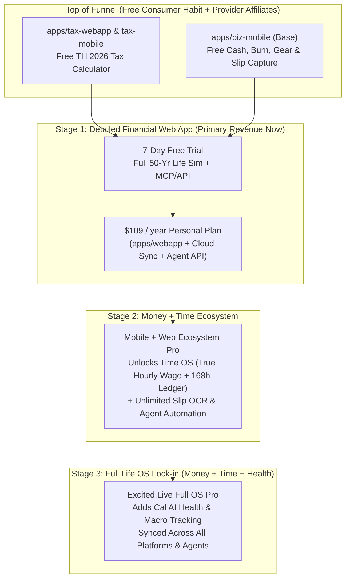

# PRD — Pricing & Monetization Funnel (Consumer-First OS Model)

> **Parent**: [PRD.md](PRD.md) · **Detailed Web App**: [prd-mlp.md](prd-mlp.md) · **Mobile Entry**: [prd-biz-mobile.md](prd-biz-mobile.md) · **Expansion**: [prd-post-mlp.md](prd-post-mlp.md)  
> **Revision 4 (2026-10-17)**: All-in on the **Consumer (B2C) Funnel**. Mobile apps (`biz-mobile`, `tax-mobile`) and `tax-webapp` serve as the free top-of-funnel habit; the detailed 50-year web planner (`apps/webapp`) is the Stage 1 paid conversion engine ($109/year); Mobile/OS Pro plans unlock as Time and Health pillars ship. B2B Advisor seats are deferred to Priority 2 backlog.

---

## 1. Strategic Monetization Progression

---

## 2. Consumer Tiers & Funnel Rules

### 2.1 Free Top-of-Funnel (`biz-mobile`, `tax-mobile`, `tax-webapp`)
- **Price**: **Free ($0)**
- **What's Included**:
  - **`apps/tax-webapp` & `apps/tax-mobile`**: Full Thailand 2026 personal income tax calculator, deduction breakdown, and ThaiESG/RMF quick estimate (zero signup required).
  - **`apps/biz-mobile` (Base)**: Multi-entity cash reserve, recurring subscription burn, straight-line hardware depreciation, Fulltime Job "UNTIL" card, capital transfers, and base Thai bank e-slip capture.
- **Provider-Side Monetization (Contextual Affiliates / Sponsorships)**:
  - Before charging free mobile/tax users, we monetize high-intent moments via honest, math-aligned affiliate or sponsorship placements (e.g., recommended ThaiESG / RMF funds when a user calculates their tax deduction gap, or high-yield savings / solopreneur tools inside `biz-mobile`).
  - **Strict Honesty Rule**: Affiliate links never alter the deterministic math in `packages/tax`, `packages/biz`, or `packages/sim`.

### 2.2 Stage 1 Paid Core: Detailed Web Planner (`apps/webapp`)
- **Price**: **$109 / year** (THB display equivalent: **฿3,690 / year**), preceded by a **7-day free trial**.
- **When Trial Starts**: Upon completing the 5-minute onboarding wizard (`US-101`) or graduating from `biz-mobile` (`US-BIZ-011`). No credit card required to complete the wizard and see the first chart.
- **What's Included**:
  - Full 50-year life & retirement simulation (`packages/sim`), Monte Carlo P10–P90 bands, scenario toggles (`US-104`), and live what-if sliders (`US-105`).
  - Full Thailand 2026 tax optimizer (`ThaiESG` / `RMF` vs. S&P 500 real after-tax return).
  - Cloud persistence across devices + **External Personal Agent Access** (`MCP` + `/api/v1/*` + scoped Better Auth API keys).
- **Post-Trial Data Guarantee**: If a user's 7-day trial expires without subscribing, their saved plan and `biz-mobile` ledger are **never deleted or held hostage**—they can always export their JSON or continue using local/base `biz-mobile`.

### 2.3 Stage 2 & Stage 3 Expansion: Mobile Pro & Full OS Lock-in
- **Stage 2 — Money + Time Pro (Launches with Pillar 2 Time OS)**:
  - Introduces a **Pro tier inside `apps/biz-mobile`** (monthly + annual options) when the Time Management pillar ships—unlocking True Net Hourly Wage, 168-hour life-energy planning, high-volume automated slip OCR, and cross-device cloud + agent sync.
- **Stage 3 — Full OS Pro Lock-in (Launches with Pillar 3 Health / Cal AI)**:
  - Bundles **Money (Slip + 50-Yr Sim) + Time (168h Activity Planner) + Health (Cal AI Photo Nutrition & Biometrics)** into the flagship `excited.live` OS membership, creating daily multi-times-a-day retention (every meal, every payment slip, every work block).

---

## 3. Payment & Billing Infrastructure

- **Processor**: Stripe Checkout & Billing Portal (`apps/api` BFF endpoints `B-5` / `B-6`).
- **Payment Methods**: Cards + **PromptPay** (for Thai users; annual renewal reminders sent 7 days and 1 day before expiry since PromptPay is push-based).
- **External AI Cost Structure**: Because we prioritize **Bring Your Own Agent (BYOA)** via MCP and API keys, users' external agents run on their own LLM subscriptions (Claude, ChatGPT, OpenRouter), keeping our inference cost near zero. For server-side slip OCR (MeowJot flow) and future Cal AI food vision, we use fast Flash-class vision models guarded by a sensible monthly fair-use cap.

---

## 4. Deferred Priority 2: B2B Advisor Tier (Backlog Only)

> **Status**: Deferred to [prd-post-mlp.md](prd-post-mlp.md) §5. We do **not** build or market the Advisor tier until the consumer B2C funnel is established.

- **Planned Spec (When Triggered)**: **$59 / month** or **$599 / year** for financial advisors; includes 5 active client seats + unlimited 30-day client trial seats, with BYOK or $9.99 / 30k credit packs.
