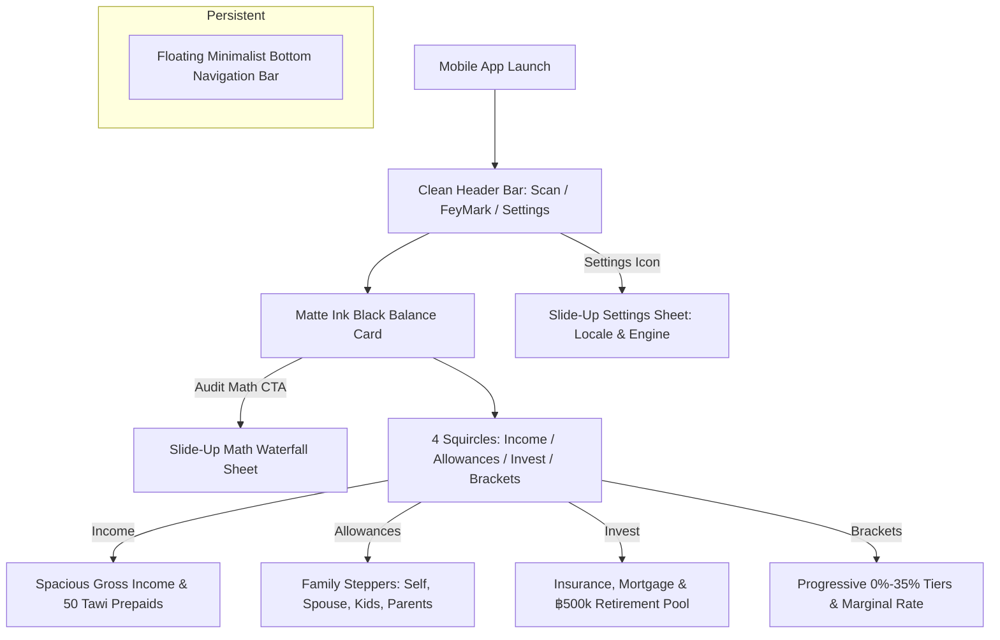

# Excited Tax Mobile (iOS / Android) — PRD, User Flows & UI Specification

> **Version**: 1.3  
> **Target Package**: [`apps/tax-mobile`](file:///home/prame/.t3/worktrees/excited.live/t3code-3cc6b039/apps/tax-mobile)  
> **Core Engine**: [`@excited-live/tax`](file:///home/prame/.t3/worktrees/excited.live/t3code-3cc6b039/packages/tax) (TH 2026 / US 2026)  
> **Design Tokens**: Canonical Mastercard Design System ([`DESIGN.md`](file:///home/prame/.t3/worktrees/excited.live/t3code-3cc6b039/DESIGN.md) & [`@excited-live/design-system/mastercard-theme.css`](file:///home/prame/.t3/worktrees/excited.live/t3code-3cc6b039/packages/design-system/src/mastercard-theme.css))

---

## 1. Executive Summary & Vision

The **Excited Tax Mobile App** is a luxury, privacy-first personal income tax companion designed for modern mobile users (salaried professionals, freelancers, gig workers, and multi-income creators). 

Adhering strictly to excited.live's **Mastercard Design System** ([`DESIGN.md`](file:///home/prame/.t3/worktrees/excited.live/t3code-3cc6b039/DESIGN.md)):
1. **Authentic Paper Surfaces**: Muted Canvas Cream (`#F3F0EE`) body background paired with Lifted Cream (`#FCFBFA`) cards for authentic "paper-on-paper lift, never sterile white". Absolutely no programmatic neon or yellow-orange sunrise gradients.
2. **Ink Black & Signal Orange**: Confident Ink Black (`#141413`) typography and primary CTAs. Signal Orange (`#CF4500` / `#F37338`) reserved as the single sharp attention cue (brand dot, active pill indicators).
3. **World App / Revolut Mobile Ergonomics**: Minimalist status header with [`FeyMark`](file:///home/prame/.t3/worktrees/excited.live/t3code-3cc6b039/packages/design-system/src/icons.tsx#L92-L100) branding, matte Ink Black hero card with 32px rounded corners, 4 squircle category shortcuts (*Income*, *Allowances*, *Invest*, *Brackets*), and a floating pill bottom dock.
4. **Live Thousand Separator Formatting (`MoneyInput`)**: Seamless digit grouping with caret position preservation and native mobile decimal keyboard support.
5. **Zero-Knowledge On-Device Privacy**: 100% computed on-device with zero financial data transmissions.

---

## 2. Visual UI Drafts & Screen Architecture

### 2.1 Mobile UI Mockups

````carousel

<!-- slide -->

<!-- slide -->

````

### 2.2 Screen Flow & Information Architecture



---

## 3. Design Token Mapping (`DESIGN.md` & `@excited-live/design-system`)

| Token Role | Hex / Value | Semantic Role in Tax Mobile |
| :--- | :--- | :--- |
| **Canvas Cream** | `#F3F0EE` | Default page background. Solid putty tone, zero artificial programmatic gradients. |
| **Lifted Cream** | `#FCFBFA` | Cards and container surfaces. Delivers paper-on-paper lift without sterile white. |
| **Pure White** | `#FFFFFF` | Reserved strictly for floating pill dock, "Audit Math" button, and modal bottom sheet. |
| **Ink Black** | `#141413` | Primary numbers, headings, hero card background, active shortcut squircles. |
| **Slate Gray** | `#696969` | Secondary descriptions, hints, inactive navigation buttons, bracket ranges. |
| **Dust Taupe** | `#D1CDC7` | Input placeholder text, bottom sheet grab handles. |
| **Signal Orange** | `#CF4500` | The single aggressive accent: focus borders, active indicators, brand dot. |
| **Light Signal Orange** | `#F37338` | Attention cue: active tab indicators, eyebrow dots, retirement progress fill. |
| **Clay Brown** | `#9A3A0A` | Warning and caution text (e.g. ฿500k cap exceeded, reset data action). |
| **Border Subtle** | `rgba(20, 20, 19, 0.08)` | Crisp 1px hairline card borders. |
